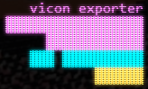

# Vicon Exporter

A small Python tool for processing Vicon Shogun takes (`.mcp`) with Shogun Post CL. It generates HSL scripts, runs Shogun, and writes predictable mocap exports for the local pipeline.

Important: this code requires Vicon Shogun Post with `ShogunPostCL.exe`. Set the executable path in `configuration/settings.py`.

## Features

- Runs Shogun Post CL with live streaming output.
- Generates HSL scripts for each take.
- Exports actor `.fbx`, `.bvh`, `.c3d`, and `.mcp` files.
- Runs mannequin, legacy MetaHuman-adjusted, and Geeno retarget exports.
- Can read aLigner `*.export.yaml` files and export an aligned frame range without overwriting the classic output.
- Finds take folders recursively from a selected root folder.

## Install

Use uv from the repository root:

```powershell
uv sync
```

Then run:

```powershell
uv run main.py
```

The menu follows three steps: choose a take or batch folder, select outputs,
and choose Keep or Overwrite. The **Exports** tab groups **Full take** and
**Aligned take** outputs side by side. Eye-tracker extras belong to Standard export; selecting them
also selects Standard export. Existing takes in Keep mode receive only missing
extras. The **Legacy methods** tab contains the older tutorial and saved-VSR
MetaHuman workflows; its tab shows a count when any are selected. BVH conversion
and face-video renaming are under **Utilities**.

If you do not use uv, install the dependencies from `pyproject.toml` into a Python environment and run:

```powershell
python main.py
```

## Main Outputs

Aligned take also provides independent **All visible props in one C3D** and
**Unlabeled markers · calibration only** options. Both use the same C3D crop
policy and original take MCP as the individual prop export. The calibration
option runs only if a folder in the take's path contains `calibration`
(case-insensitive). It uses Vicon's documented `_*` marker selector for unlabeled
trajectories and keeps only markers with translation samples in the crop.

Additional C3Ds live in `aligned_exports/props/`, normally named
`__vicon_exporter_all_props__.c3d` and
`__vicon_exporter_calibration_markers__.c3d`. A numbered suffix is added when a
name conflicts with a prop file. Actual names are recorded in
`aligned_exports/reports/aligned_scene_extras.yaml`. Keep can add missing extras
without replacing individual props; Overwrite updates only the selected groups.
The combined file includes only visible props and retains subject-qualified
marker labels to avoid collisions between different props' marker names.

**Aligned take → Visible props · C3D** independently exports Vicon's Props
category to `aligned_exports/props/<prop name>.c3d`. Props need at least one
marker translation sample within the inclusive crop interval; props with no
samples there are skipped. Existing gap-filled samples count as data.

The crop comes from C3D entries in the aLigner export YAML (not BVH entries).
Both aligned exporters select the most recently modified full export YAML
across the supported metadata folders, regardless of the take folder's name.
Slim exports are considered only when no full export YAML is present.
The default uses the first C3D in YAML order; the optional **Earliest start /
latest end** policy covers all C3D ranges. Differing ranges produce a warning
at the end of the batch and are recorded in `reports/aligned_props_summary.yaml`.
Keep preserves an existing props output group. Overwrite replaces that group
after a successful Shogun run, removing old C3Ds for props no longer visible.
The source MCP is loaded without changing the original file.

The classic exporter writes to:

```text
take/
  exported/
    markers_world.c3d
    clapperboard.c3d
    eye_tracker_1.c3d
    eye_tracker_2.c3d
    calibration_markers.c3d  # only for takes inside a calibration folder
    actors/
      <actor>_.c3d
      <actor>_.fbx
      <actor>_.bvh
      <actor>_.mcp
```

The eye tracker and calibration free-marker exports are enabled with the
`Include eye tracker + calibration free markers` menu option. If an exported
take is missing only one eye tracker file, rerunning the export with this option
generates just the missing extra file.

Actor filenames normally retain the historical three-letter stem, such as
`Jam_.c3d`. If two character names in the same scene share that stem, the
exporter uses their full character names for the whole colliding group instead,
for example `James_.c3d` and `Jamie_.c3d`. The same rule is used for C3D, FBX,
BVH, MCP, aligned exports, and saved-VSR retarget exports, preventing one actor
from overwriting the other.

BVH export is still attempted by default. If Shogun rejects a classical
no-fingers character with the known `multiple zero dof end bones` BVH error, the
exporter first retries with a static-hand BVH fallback that enables hand/finger
rotation DOFs before saving BVH. If Shogun still rejects the skeleton, it retries
without only the BVH save step, leaving C3D, FBX, and MCP exports intact.
Production 10-finger characters should keep producing BVH as before.

The aLigner-compatible exporter writes to a separate folder:

```text
take/
  aligned_exports/
    actors/
      <actor>_aligned.c3d
      <actor>_aligned.fbx
      <actor>_aligned.bvh
      <actor>_aligned.mcp
    retargeted/
      metahuman/
        <actor>_metahuman_aligned.fbx
      geeno/
        <actor>_geeno_aligned.fbx
    reports/
      aligned_export_summary.yaml
    scripts/
      aligned_export_all_actors.hsl
      aligned_retarget_metahuman.hsl
      aligned_retarget_geeno.hsl
```

Choose **Keep existing exports** (the default) or **Overwrite selected exports**
in the menu. Keep skips an aligned output group if its directory already contains
files: standard actors, MetaHuman, and Geeno are separate groups. It does not fill
partial groups; choose Overwrite to regenerate them. Standalone retargets also
skip existing exports for their selected target in Keep mode. Classic export
keeps its existing skip behavior and can still add missing tracking props.
Overwrite reruns selected exports without deleting the classic export folder or
unrelated retargets. The aligned workflow writes only to `aligned_exports/`;
the `exported/` and aLigner metadata folders are left untouched by that workflow.

## aLigner Workflow

After the classic export and an aLigner run, each take should contain:

```text
take/
  exported/
  aligner._data/
    <take>.export.yaml
    <take>.state.yaml
```

Use the menu option:

```text
Standard aligned export (C3D, FBX, BVH, MCP)
Aligned MetaHuman retarget
Aligned Geeno retarget
```

That pass reads the aLigner `*.export.yaml`, finds the MOCAP actor entries under `exported/actors`, and uses the exported local start/end frame values to generate HSL with:

```hsl
playRange <start_frame> <end_frame>;
```

Select any combination. Standard export produces cropped actor files without
retargeting. MetaHuman and Geeno each retarget the take MCP over the aligned frame
range, so either can run independently of standard aligned export.

### Export status

Each aligned step that writes outputs records the aLigner values it used (actor
frame ranges for actor exports and retargets, C3D crop ranges for props) in
`aligned_exports/reports/export_status.yaml`, with paths relative to the take.
Steps that keep existing files do not record anything.

```powershell
uv run status.py [FOLDER]
```

or **Export status…** in the menu opens a read-only table: one row per take,
one column per aligned step. A step is **outdated** when the take's current
aLigner export YAML gives different values than it was exported with; the details
list what changed (e.g. `Jam_.bvh: frames 0–67764 → 4414–72174`). Export it again
with Overwrite. Outputs from before status tracking are compared with the frame
ranges in their older reports when available, otherwise shown as unverified.
Only files in the take folder are read, so aLigner does not need to be installed.

The **aLigner exported** column shows when aLigner last wrote the take's export
YAML. ⚠ there means the alignment state was saved later without exporting, so
the YAML may hold older values: export again from aLigner first.

The **3D range** column shows the frames and rate the aLigner export gives the
take's 3D files (BVH, C3D). They should all share one range; when they don't,
the column shows ⚠, the row is highlighted, and the **3D ranges differ** filter
lists those takes. Selecting a take draws its 3D files as bars on one time axis
above the details, with the files off the shared range in red and their offset
in frames.

Each state has one symbol, used everywhere: ✓ current, ⚠ outdated, ✗ missing
(recorded files gone), ✗ failed (the last export of the step failed), ? not
verified, – not exported.

Select takes (Ctrl/Shift+click, or **Select all shown** after filtering) and press
**Export selected…** to choose steps; steps that need a new export in any
selected take are preselected, with Overwrite on. The export runs in its own
console, which shows Shogun's full output. While it runs, the table shows ⟳ and
the elapsed time in the step running now, and each take refreshes as soon as one
of its steps ends. **Stop after this step** lets the running step finish so its
files are complete, then skips the rest. A failed step stays ✗ failed until it
exports again; select the take to see the error, and **Open Shogun log** (or a
double-click on the step) opens the log of that run. The same runs from the
command line without the menu:

```powershell
uv run main.py --take <take> --take <take> --steps actors,geeno --overwrite
```

Steps: `original` (the full-range export aLigner reads, with eye trackers and
calibration markers), then the aligned `actors`, `props`, `all_props`,
`calibration_markers`, `metahuman`, `geeno`; `--prop-crop first|extremes`.
`--shogun-mode runscript|old` overrides `SHOGUN_MODE` for one run, and
`--report <file>` sets where the batch results JSON goes.

### Timing the export

`tools/time_export.py` runs the chosen steps on one take with Overwrite, once per
Shogun mode, prints the seconds of every step side by side, and checks that both
modes wrote the same files with the same sizes:

```powershell
uv run python tools/time_export.py --take D:/copy/take --steps original,actors,props,metahuman
```

It replaces the take's exports, so run it on a copy of the take. The table, the
two batch reports and the file comparison are saved in
`take/.vicon_exporter_reports/timing_<date>/`. `--modes runscript,old` swaps the
order; the second run can be faster only because Windows still has the take
file in memory.

## Data Tree Normalization

Use `utils/normalize_data_tree.py` when an exported data folder needs safer,
more uniform names. The script is dry-run first: it writes a CSV/JSON plan and
an undo PowerShell script, checks for name collisions, and only renames files or
folders when `--apply` is passed.

The default rules are intentionally conservative:

- `DD-MM-YYYY` becomes `YYYY-MM-DD`.
- If a folder has both a date and a session label, the date moves first.
- `mocap` is removed from names.
- repeated underscores are collapsed to one underscore.
- `take1`, `take 1`, and `take_1` become `001`.
- official IDs such as `S021`, `S001-S003`, and `I04` are preserved.
- YAML file names are included by default, but non-YAML file names are left alone.

First produce and review the plan:

```powershell
uv run python utils/normalize_data_tree.py "D:\path\to\data"
```

If the plan looks correct, apply only the path renames:

```powershell
uv run python utils/normalize_data_tree.py "D:\path\to\data" --apply
```

To also update exact old names and relative paths inside `.yaml`/`.yml` files,
add `--rewrite-yaml`. YAML files are copied to `*.before-normalize.bak` before
their contents are changed.

```powershell
uv run python utils/normalize_data_tree.py "D:\path\to\data" --apply --rewrite-yaml
```

Only use `--include-files` after reviewing a dry-run plan carefully. It extends
the same naming rules to non-YAML file names, which can break external tools if
those files are referenced by generated metadata.

## Retarget Types

There are two mannequin-style retarget modes:

- `mannequin`: uses `models/basic_mannequin.vsr` with `hsl/retarget_general_template.hsl`. This is the simpler path. It selects each Shogun character, loads the VSR, retargets, selects the retargeting hierarchy, and exports FBX.
- `mannequin adjusted`: uses `models/adjusted_mannequin.vsr` with `hsl/retarget_mannequin_template_adjusted_for_metahuman.hsl`. It retargets once, moves forearm `Rz` twist from the forearm to the hand on both arms, runs `solve`, then retargets again. This is intended for the MetaHuman-adjusted setup, but because it touches the solve skeleton it is more fragile in Shogun.

Geeno retargeting uses `models/geeno.vsr` with the general retarget template.

Vicon's [automated MetaHuman setup documentation](https://vicon-help.atlassian.net/wiki/spaces/ShogunPost121/pages/1253738008/Automate+retargeting+to+MetaHuman)
describes preparing a retarget setup using `SetupRetargetToUE5Mannequin.hsl`.
It requires one solved standard Shogun VSS subject and a UE5 MetaHuman or
Mannequin FBX with the `Character/Retargeting/[Locator]/root/pelvis` hierarchy
(Mannequin from UE 5.0.3 or later). Prepare and validate that setup in Shogun
before saving the VSR used by the batch exporters.

Each full-take retarget method writes to its own folder:

```text
take/exported/retargeted/metahuman_legacy/  # adjusted, older tutorial method
take/exported/retargeted/metahuman_vsr/     # basic mannequin VSR method
take/exported/retargeted/geeno/
```

Retargets read the original take MCP. Aligned YAML source paths are resolved
against the selected take's `exported/actors/` directory, allowing exports to
move between PCs, drive letters, and operating systems without editing the YAML.

Shogun runs each script with `-runScript`: the exporter writes a
`<script>.runscript.hsl` copy that starts with `loadFile` on the take MCP, and
sends `exit` when the script is done. Nothing else is written. The older `-old`
mode also writes a full copy of the take, which takes about as long as loading
it and roughly doubles each run. Set `SHOGUN_MODE = "old"` in
`configuration/settings.py` to compare; that copy goes to a temporary folder
and is deleted. `processed.mcp` or `temp_*.mcp` files left by older runs are
never mistaken for the original take MCP.

Every run writes `shogun time: N s` at the end of its `.shogun.log`, and the
batch results in `.vicon_exporter_reports/` give each step's `seconds` and
`shogun_seconds`.

The aligned `metahuman` output intentionally uses the basic mannequin retarget path because it is less invasive and has been the more reliable Shogun CL path. The adjusted MetaHuman template is still available from the separate menu option, but it touches the solve skeleton and may fail with Shogun script errors around `setProperty -onMod`.

## Generated HSL Files

The app writes aligned workflow HSL files into the aligned export folder so they can be inspected and run manually:

```text
take/
  aligned_exports/
    scripts/
      aligned_export_all_actors.hsl
      aligned_retarget_metahuman.hsl
      aligned_retarget_geeno.hsl
```

Shogun Post CL does not always surface detailed script context, so these generated files are the best place to inspect exact line numbers after an error.

## Project Layout

```text
vicon_exporter/
  bvh/
  configuration/
  exporter/
  hsl/
  models/
  ui/
  utils/
  tools/
  wrapper/
  main.py
  pyproject.toml
  uv.lock
```
